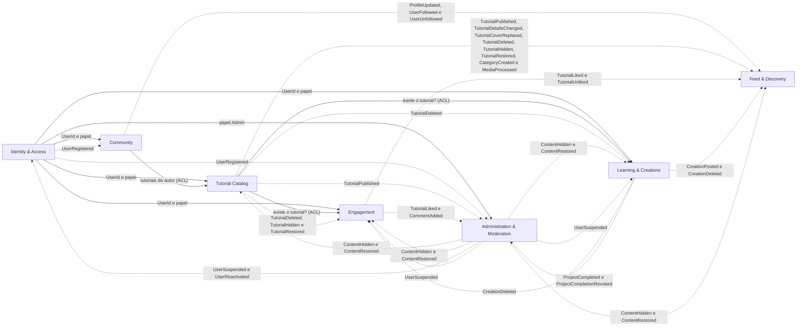
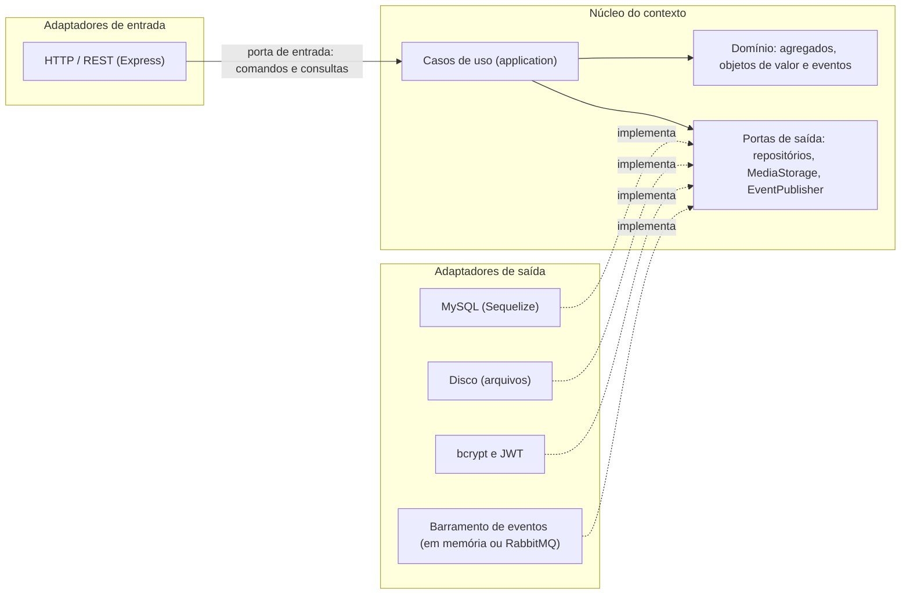

# CraftCorner: arquitetura orientada a DDD

Questão 1: transformar a arquitetura e o domínio do projeto de Programação Web (**CraftCorner**) em uma arquitetura voltada para **Domain-Driven Design (DDD)**.

> Este repositório contém a **organização da arquitetura** (contextos, camadas, pastas e documentação). O código-fonte da aplicação web não é necessário para esta questão. Cada pasta tem um `README.md` que diz o que ela guarda e quais arquivos são previstos.

## Domínio de aplicação

O CraftCorner é uma plataforma web de aprendizado e compartilhamento de artesanato. Criadores de conteúdo publicam tutoriais, com imagem de capa e vídeo, organizados por tipo de artesanato (como crochê e amigurumi), e aprendizes exploram esses tutoriais, assistem aos vídeos, marcam projetos como concluídos e compartilham fotos das próprias criações. A comunidade interage por meio de curtidas, comentários e avaliações, e as pessoas podem seguir criadores para acompanhar as publicações deles em um feed "Seguindo", além do feed "Geral", que reúne todo o conteúdo. A administração gerencia tutoriais e categorias, acompanha estatísticas em um dashboard e modera conteúdos e usuários para manter a plataforma segura. O sistema atende a dois perfis: membros (aprendizes e criadores) e administradores.

## Visão geral

Do ponto de vista do negócio, o CraftCorner foi dividido em **sete contextos delimitados** (bounded contexts). Cada um tem o seu modelo, o seu vocabulário e as suas regras, e conversam por portas e eventos.



Setas contínuas: consulta por porta. Setas pontilhadas: evento de domínio (a lista completa, com publicador, consumidores e dados, está em [eventos de domínio](docs/06-eventos-de-dominio.md)).

## Os contextos

| Contexto | Subdomínio | Responsabilidade | Situação |
|---|---|---|---|
| [`identity-access`](src/contexts/identity-access) | Genérico | Cadastro de contas, autenticação e papéis (Membro ou Administrador). Responde à pergunta "quem é você e o que pode fazer?". | ✅ Implementado |
| [`community`](src/contexts/community) | Suporte | Perfil público das pessoas e a relação de seguir e deixar de seguir criadores. | 🟡 Parcial |
| [`tutorial-catalog`](src/contexts/tutorial-catalog) | Core | Publicação, edição, exclusão e consulta de tutoriais (imagem de capa e vídeo), organizados por categoria (tipo de artesanato). | ✅ Implementado |
| [`engagement`](src/contexts/engagement) | Suporte | Interações das pessoas com o conteúdo: curtir, comentar, avaliar e contar visualizações. Mantém as estatísticas de cada tutorial. | 🟡 Parcial |
| [`learning-creations`](src/contexts/learning-creations) | Core | O progresso de quem aprende (marcar projetos concluídos) e as fotos das criações pessoais compartilhadas com a comunidade. | 🕒 Planejado |
| [`feed-discovery`](src/contexts/feed-discovery) | Suporte | Lado de leitura da plataforma: feed Geral, feed Seguindo, exploração por categoria e busca. Não tem agregados, apenas modelos de leitura montados a partir de eventos. | 🟡 Parcial |
| [`administration-moderation`](src/contexts/administration-moderation) | Suporte | Dashboard com estatísticas e moderação de conteúdos e usuários. As decisões viram eventos que os outros contextos obedecem. | 🕒 Planejado |


O **Core Domain** é ensinar e praticar artesanato (Catálogo de Tutoriais e Aprendizado e Criações). Identidade e Acesso é um subdomínio **genérico**. Ver [domínio e subdomínios](docs/01-dominio-e-subdominios.md).

## Estrutura do repositório

```text
craftcorner-ddd/
├── README.md
├── docs/
│   ├── 01-dominio-e-subdominios.md
│   ├── 02-linguagem-ubiqua.md
│   ├── 03-contextos-delimitados-e-context-map.md
│   ├── 04-modelo-tatico.md
│   ├── 05-arquitetura-em-camadas.md
│   ├── 06-eventos-de-dominio.md
│   ├── 07-mapeamento-projeto-atual.md
│   ├── 08-decisoes-arquiteturais.md
│   ├── 09-camada-de-mensageria.md
│   ├── apresentacao.md
│   └── c4/                       (diagramas C4: contexto, contêineres e componentes)
├── src/
│   ├── bootstrap/
│   ├── shared-kernel/
│   └── contexts/
│       ├── administration-moderation/
│       │   ├── application/
│       │   ├── domain/
│       │   ├── infrastructure/
│       │   └── interfaces/
│       ├── community/
│       │   ├── application/
│       │   ├── domain/
│       │   ├── infrastructure/
│       │   └── interfaces/
│       ├── engagement/
│       │   ├── application/
│       │   ├── domain/
│       │   ├── infrastructure/
│       │   └── interfaces/
│       ├── feed-discovery/
│       │   ├── application/
│       │   ├── domain/
│       │   ├── infrastructure/
│       │   └── interfaces/
│       ├── identity-access/
│       │   ├── application/
│       │   ├── domain/
│       │   ├── infrastructure/
│       │   └── interfaces/
│       ├── learning-creations/
│       │   ├── application/
│       │   ├── domain/
│       │   ├── infrastructure/
│       │   └── interfaces/
│       └── tutorial-catalog/
│           ├── application/
│           ├── domain/
│           ├── infrastructure/
│           └── interfaces/
└── tests/
```

Dentro de cada contexto, as quatro camadas são `domain`, `application`, `infrastructure` e `interfaces`. A regra de dependência aponta sempre para o domínio ([camadas](docs/05-arquitetura-em-camadas.md)).

## Documentação

| # | Documento | O que responde |
|---|---|---|
| 1 | [Domínio e subdomínios](docs/01-dominio-e-subdominios.md) | Qual é o domínio, quem são os atores e o que é Core, Suporte e Genérico? |
| 2 | [Linguagem ubíqua](docs/02-linguagem-ubiqua.md) | Que palavras o negócio e o código compartilham? |
| 3 | [Contextos e mapa de contextos](docs/03-contextos-delimitados-e-context-map.md) | Quais contextos existem e como se relacionam? |
| 4 | [Modelo tático](docs/04-modelo-tatico.md) | Quais são os agregados, objetos de valor, invariantes e repositórios? |
| 5 | [Arquitetura em camadas](docs/05-arquitetura-em-camadas.md) | Como o código é organizado e para onde apontam as dependências? |
| 6 | [Eventos de domínio](docs/06-eventos-de-dominio.md) | Que fatos circulam entre os contextos? |
| 7 | [Do projeto atual para o DDD](docs/07-mapeamento-projeto-atual.md) | O que existe hoje, o que muda e como migrar? |
| 8 | [Decisões arquiteturais](docs/08-decisoes-arquiteturais.md) | Por que foi desenhado assim? |
| 9 | [Camada de mensageria](docs/09-camada-de-mensageria.md) | Como os eventos viajam entre processos (RabbitMQ e outbox) e como isso aparece no modelo C4? |
| — | [Roteiro de apresentação](docs/apresentacao.md) | Como apresentar em 5 minutos? |

## Arquitetura hexagonal (portas e adaptadores)

A organização em camadas **é** uma arquitetura hexagonal: o domínio e os casos de uso formam o **núcleo**, e tudo o que é tecnologia fica nas bordas, ligado ao núcleo por **portas** (interfaces).



A tabela completa de portas e adaptadores de cada contexto está em [arquitetura em camadas, seção 5.7](docs/05-arquitetura-em-camadas.md).

## Princípios adotados

- **DDD estratégico:** domínio e subdomínios, contextos delimitados, mapa de contextos, linguagem ubíqua.
- **DDD tático:** agregados com invariantes, objetos de valor, serviços de domínio, repositórios, eventos de domínio.
- **Dependência para dentro:** o domínio não conhece banco, HTTP nem frameworks.
- **Referência por identificador** entre agregados e **eventos** entre contextos.

## Situação

✅ Implementado: a funcionalidade já existe no projeto atual (os eventos de domínio e as portas fazem parte do redesenho: o código atual ainda não os publica). 🟡 Parcial: existe em parte. 🕒 Planejado: faz parte do domínio descrito, mas ainda não foi implementado; já tem o seu lugar na arquitetura.

**Autor:** Lucas Costa Izidoro
