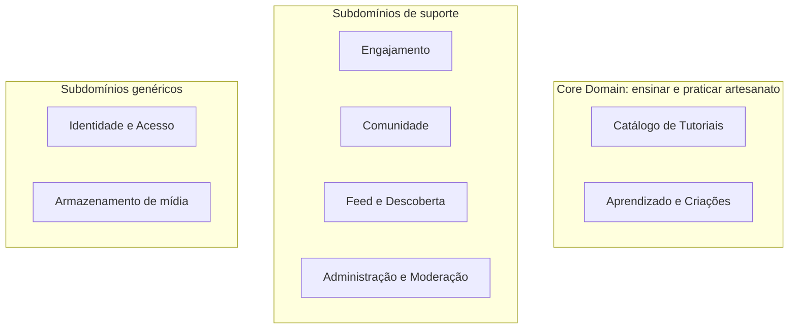
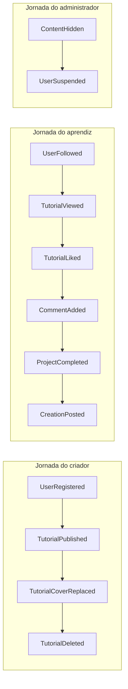

# 1. Domínio e subdomínios

## 1.1 Domínio de aplicação

O CraftCorner é uma plataforma web de aprendizado e compartilhamento de artesanato. Criadores de conteúdo publicam tutoriais, com imagem de capa e vídeo, organizados por tipo de artesanato (como crochê e amigurumi), e aprendizes exploram esses tutoriais, assistem aos vídeos, marcam projetos como concluídos e compartilham fotos das próprias criações. A comunidade interage por meio de curtidas, comentários e avaliações, e as pessoas podem seguir criadores para acompanhar as publicações deles em um feed "Seguindo", além do feed "Geral", que reúne todo o conteúdo. A administração gerencia tutoriais e categorias, acompanha estatísticas em um dashboard e modera conteúdos e usuários para manter a plataforma segura. O sistema atende a dois perfis: membros (aprendizes e criadores) e administradores.

## 1.2 Atores

| Ator | O que faz na plataforma |
|---|---|
| **Visitante** | Explora o feed Geral e os tutoriais, lê comentários e vê perfis públicos, sem conta. |
| **Membro** | Com conta, assiste aos tutoriais, curte, comenta, avalia, marca projetos concluídos, compartilha criações e segue criadores. |
| **Criador** | Um Membro que publica tutoriais (capa e vídeo) e gerencia os próprios tutoriais. |
| **Administrador** | Gerencia tutoriais e categorias, acompanha o dashboard e modera conteúdos e usuários. |

## 1.3 Capacidades de negócio (funcionalidades do projeto)

| Capacidade | Contexto responsável |
|---|---|
| Cadastro e autenticação | Identity & Access |
| Perfil público e seguir ou deixar de seguir criadores | Community |
| Publicar, editar e excluir tutoriais; explorar por tipo de artesanato | Tutorial Catalog |
| Curtir, comentar e avaliar; contar visualizações | Engagement |
| Assistir vídeos e marcar projetos concluídos; compartilhar criações | Learning & Creations |
| Feed Geral, feed Seguindo e busca | Feed & Discovery |
| Dashboard, gerência de categorias e moderação | Administration & Moderation |

## 1.4 Classificação dos subdomínios

O **Core Domain** é o que diferencia o CraftCorner de qualquer outro site de vídeos: **ensinar e praticar artesanato**. É onde o investimento de modelagem deve ser maior.

| Subdomínio | Tipo | Por quê |
|---|---|---|
| Catálogo de Tutoriais | **Core** | É o produto: o jeito de publicar, organizar por tipo de artesanato e entregar o vídeo define a experiência. |
| Aprendizado e Criações | **Core** | Diferencia a plataforma de um simples site de vídeos: quem aprende registra o progresso e mostra o que fez. |
| Engajamento | Suporte | Essencial para a comunidade, mas curtir e comentar são capacidades conhecidas. |
| Comunidade | Suporte | Perfis e seguidores sustentam o produto, sem serem o diferencial. |
| Feed e Descoberta | Suporte | Leitura sobre dados dos outros contextos. |
| Administração e Moderação | Suporte | Necessária para operar com segurança, sem diferenciar o produto. |
| Identidade e Acesso | **Genérico** | Cadastro, login e papéis são iguais em qualquer sistema; deve-se usar solução padrão (hash de senha e JWT). |
| Armazenamento de mídia | **Genérico** | Salvar e apagar arquivos é uma capacidade técnica, escondida atrás de uma porta (`MediaStorage`). |

## 1.5 Jornadas e eventos (visão de Event Storming simplificada)

Esses eventos, no passado, são os fatos que importam ao negócio. Eles guiam os limites dos contextos e a comunicação entre eles (ver [eventos de domínio](06-eventos-de-dominio.md)).
