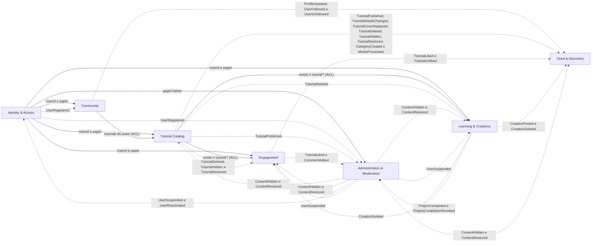

# 3. Contextos delimitados e mapa de contextos

## 3.1 Os sete contextos

| Contexto | Nome em português | Subdomínio | Situação | Responsabilidade |
|---|---|---|---|---|
| **Identity & Access** | Identidade e Acesso | Genérico | ✅ Implementado | Cadastro de contas, autenticação e papéis (Membro ou Administrador). Responde à pergunta "quem é você e o que pode fazer?". |
| **Community** | Comunidade (Perfis e Seguidores) | Suporte | 🟡 Parcial | Perfil público das pessoas e a relação de seguir e deixar de seguir criadores. |
| **Tutorial Catalog** | Catálogo de Tutoriais | Core | ✅ Implementado | Publicação, edição, exclusão e consulta de tutoriais (imagem de capa e vídeo), organizados por categoria (tipo de artesanato). |
| **Engagement** | Engajamento (Curtidas, Comentários, Avaliações e Métricas) | Suporte | 🟡 Parcial | Interações das pessoas com o conteúdo: curtir, comentar, avaliar e contar visualizações. Mantém as estatísticas de cada tutorial. |
| **Learning & Creations** | Aprendizado e Criações | Core | 🕒 Planejado | O progresso de quem aprende (marcar projetos concluídos) e as fotos das criações pessoais compartilhadas com a comunidade. |
| **Feed & Discovery** | Feed e Descoberta | Suporte | 🟡 Parcial | Lado de leitura da plataforma: feed Geral, feed Seguindo, exploração por categoria e busca. Não tem agregados, apenas modelos de leitura montados a partir de eventos. |
| **Administration & Moderation** | Administração e Moderação | Suporte | 🕒 Planejado | Dashboard com estatísticas e moderação de conteúdos e usuários. As decisões viram eventos que os outros contextos obedecem. |

Cada contexto tem a sua pasta em [`src/contexts`](../src/contexts), o seu modelo, o seu vocabulário e as suas tabelas. Nenhum contexto lê as tabelas do outro: conversam por **portas** (consultas) e por **eventos**.

## 3.2 Mapa de contextos

Setas contínuas são **consultas por porta**; setas pontilhadas são **eventos de domínio**. O mapa mostra todos os pares publicador e consumidor do [catálogo de eventos](06-eventos-de-dominio.md).

## 3.3 Padrões de relacionamento usados

| Relação | Padrão (DDD estratégico) | Como funciona |
|---|---|---|
| Identity & Access → todos | **Open Host Service + Published Language** | Publica uma linguagem simples e estável (`UserId` e papel). Os outros contextos se **conformam** (Conformist) e só guardam o identificador. |
| Tutorial Catalog → Engagement e Learning & Creations | **Customer/Supplier + Anticorruption Layer** | Eles precisam saber se um tutorial existe. Usam a porta `TutorialLookup`, e o adaptador traduz a resposta do Catálogo para o vocabulário local, sem importar suas classes. |
| Community → Tutorial Catalog | **Customer/Supplier + ACL** | O perfil público mostra os tutoriais da pessoa, pedidos pela porta `TutorialCatalogReader`. |
| Catálogo, Comunidade, Criações e Engajamento → Feed & Discovery | **Published Language (eventos)** | O Feed é **downstream** puro: escuta eventos e monta modelos de leitura. |
| Administration & Moderation → Catálogo, Engajamento e Identidade | **Published Language (eventos)** | A Moderação decide e publica `ContentHidden` ou `UserSuspended`. Cada contexto reage do seu jeito e continua dono dos seus dados. |
| Todos | **Shared Kernel mínimo** | Só identificadores, a base de evento e os erros. Ver [`shared-kernel`](../src/shared-kernel). |

## 3.4 Exemplo de camada anticorrupção

`Engagement` precisa saber se o tutorial a ser curtido existe e está publicado.

- **Porta** (em `engagement/application/ports/TutorialLookup.js`): `exists(tutorialId): boolean`.
- **Adaptador** (em `engagement/infrastructure/adapters/CatalogApiTutorialLookup.js`): chama a API pública do Catálogo e responde `true` ou `false`.

Se o Catálogo mudar a forma de representar um tutorial, só o adaptador muda. O domínio de Engajamento não é afetado.

## 3.5 Por que não microsserviços
Os contextos são **módulos de um monólito** (ver [ADR-001](08-decisoes-arquiteturais.md)): fronteiras claras e eventos entre eles, mas um único deploy. Se um dia um contexto precisar escalar sozinho (o Feed, por exemplo), ele já está pronto para sair, porque só conversa por portas e eventos.
