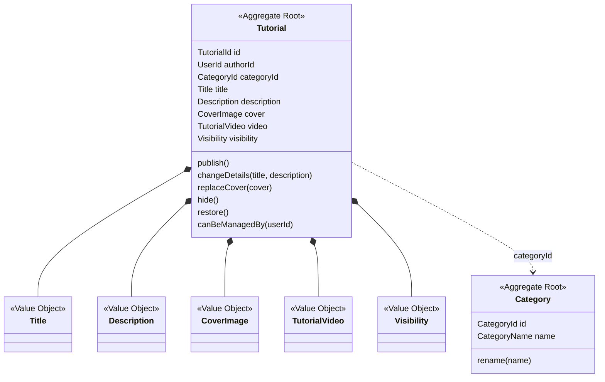
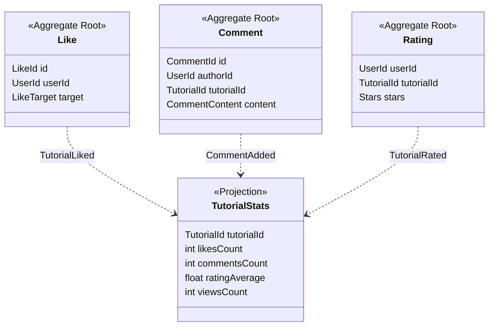

# 4. Modelo tático (agregados, entidades, objetos de valor, serviços e repositórios)

## 4.1 Regras do modelo

1. **Agregado = fronteira de consistência.** Uma transação altera **um** agregado.
2. **Agregados se referenciam por identificador** (`authorId`, `tutorialId`), nunca por objeto. Isso substitui as associações entre tabelas feitas hoje em `config/associations.js`.
3. **Invariantes moram no agregado e nos objetos de valor**, não em controllers nem em rotas.
4. **Objetos de valor validam a si mesmos** (por exemplo, `Title` aplica o `trim` e só depois confere se não está vazio).
5. **Repositório é uma interface do domínio**, com uma coleção de agregados como vocabulário. A implementação fica na infraestrutura.
6. **Contadores não são do agregado**: curtidas, comentários e visualizações vivem na projeção `TutorialStats` (ver [ADR-003](08-decisoes-arquiteturais.md)).

## 4.2 Agregados e invariantes por contexto

### Identity & Access

**Agregado `User`** (✅ Implementado)  
Raiz: `User` · Composição: Email, Username, PasswordHash, Role, AccountStatus

Invariantes:
- E-mail e nome de usuário são únicos.
- A senha tem no mínimo 6 caracteres e só existe como hash.
- Conta suspensa não autentica.

Comandos: `RegisterUser`, `AuthenticateUser` · Eventos: `UserRegistered`

### Community

**Agregado `Profile`** (✅ Implementado)  
Raiz: `Profile` · Composição: FullName, Bio, AvatarImage

Invariantes:
- Nome completo obrigatório (trim antes de notEmpty).
- Biografia com no máximo 255 caracteres.
- Foto antiga é apagada do disco só depois de a nova ser salva.

Comandos: `UpdateProfile` · Eventos: `ProfileUpdated`

**Agregado `FollowRelation`** (🕒 Planejado)  
Raiz: `FollowRelation` · Composição: followerId, followedId

Invariantes:
- Ninguém segue a si mesmo.
- O par seguidor e seguido é único.

Comandos: `FollowUser`, `UnfollowUser` · Eventos: `UserFollowed`, `UserUnfollowed`

### Tutorial Catalog

**Agregado `Tutorial`** (✅ Implementado)  
Raiz: `Tutorial` · Composição: Title, Description, CoverImage, TutorialVideo (opcional), Visibility, authorId, categoryId

Invariantes:
- Título obrigatório (trim antes de notEmpty), com no máximo 100 caracteres.
- Descrição com no máximo 500 caracteres.
- A capa é obrigatória; o vídeo é opcional e não pode ser trocado depois de publicado (para trocar, exclui-se e publica-se de novo).
- Só o autor edita ou exclui (404 antes de 403).
- Excluir apaga capa e vídeo do disco, depois de o banco ser atualizado.

Comandos: `PublishTutorial`, `ChangeTutorialDetails`, `ReplaceTutorialCover`, `DeleteTutorial` · Eventos: `TutorialPublished`, `TutorialDetailsChanged`, `TutorialCoverReplaced`, `TutorialDeleted`, `TutorialHidden`, `TutorialRestored`

**Agregado `Category`** (🕒 Planejado)  
Raiz: `Category` · Composição: CategoryName

Invariantes:
- Nome único.
- Só administradores criam e renomeiam.

Comandos: `CreateCategory`, `RenameCategory` · Eventos: `CategoryCreated`

### Engagement

**Agregado `Like`** (✅ Implementado)  
Raiz: `Like` · Composição: userId, LikeTarget

Invariantes:
- Uma pessoa só curte um alvo uma vez (garantido também pelo índice único no banco).
- Curtir de novo desfaz a curtida (alternância).

Comandos: `ToggleLike` · Eventos: `TutorialLiked`, `TutorialUnliked`

**Agregado `Comment`** (✅ Implementado)  
Raiz: `Comment` · Composição: authorId, tutorialId, CommentContent

Invariantes:
- Texto com trim antes de notEmpty, de 1 a 500 caracteres.
- Só o texto aparado é guardado.
- O alvo precisa existir (404).

Comandos: `AddComment`, `RemoveComment` · Eventos: `CommentAdded`, `CommentRemoved`

**Agregado `Rating`** (🕒 Planejado)  
Raiz: `Rating` · Composição: userId, tutorialId, Stars

Invariantes:
- Nota de 1 a 5 estrelas.
- Uma avaliação por pessoa e tutorial (a nova substitui a anterior).

Comandos: `RateTutorial` · Eventos: `TutorialRated`

### Learning & Creations

**Agregado `ProjectProgress`** (🕒 Planejado)  
Raiz: `ProjectProgress` · Composição: userId, tutorialId, completedAt

Invariantes:
- Um registro por pessoa e tutorial.
- O tutorial precisa existir e estar publicado.

Comandos: `MarkProjectCompleted`, `UnmarkProjectCompleted` · Eventos: `ProjectCompleted`, `ProjectCompletionRevoked`

**Agregado `Creation`** (🕒 Planejado)  
Raiz: `Creation` · Composição: authorId, CreationPhoto, Caption, inspiredByTutorialId (opcional)

Invariantes:
- A foto é obrigatória.
- Só a autora ou o autor edita ou exclui (404 antes de 403).
- A inspiração em um tutorial é opcional e guardada só por identificador.

Comandos: `PostCreation`, `DeleteCreation` · Eventos: `CreationPosted`, `CreationDeleted`

### Feed & Discovery

Não tem agregados: é lado de leitura (CQRS), com modelos de leitura montados por eventos.

### Administration & Moderation

**Agregado `ModerationAction`** (🕒 Planejado)  
Raiz: `ModerationAction` · Composição: moderatorId, ModerationTarget, ModerationActionType, ModerationReason

Invariantes:
- Só um Admin executa.
- O motivo é obrigatório.
- Um Admin não modera a si mesmo.

Comandos: `HideContent`, `RestoreContent`, `SuspendUser`, `ReactivateUser` · Eventos: `ContentHidden`, `ContentRestored`, `UserSuspended`, `UserReactivated`

## 4.3 Diagrama: Tutorial Catalog

## 4.4 Diagrama: Engagement

## 4.5 Serviços de domínio

| Serviço | Contexto | Por que é um serviço e não parte de uma entidade |
|---|---|---|
| `CredentialsPolicy` | Identity & Access | Política de senha que envolve a senha e a confirmação, sem ser de uma entidade só. |
| `FollowPolicy` | Community | Regra que envolve duas pessoas (quem segue e quem é seguido). |
| `TutorialAccessPolicy` | Tutorial Catalog | Decide quem pode gerenciar um tutorial (autor ou Admin). |
| `ModerationPolicy` | Administration & Moderation | Só Admin, e ninguém modera a si mesmo. |

## 4.6 Repositórios (portas)

| Repositório | Contexto | Operações |
|---|---|---|
| `UserRepository` | Identity & Access | `findById`, `findByEmailOrUsername`, `existsByEmail`, `existsByUsername`, `save` |
| `ProfileRepository`, `FollowRepository` | Community | `findByUserId`, `save`, `exists(followerId, followedId)`, `remove` |
| `TutorialRepository` | Tutorial Catalog | `findById`, `save`, `delete`, `listByAuthor`, `listByCategory` |
| `CategoryRepository` | Tutorial Catalog | `findById`, `findByName`, `save` |
| `LikeRepository` | Engagement | `findByUserAndTarget`, `save`, `remove`, `listByUser` |
| `CommentRepository`, `RatingRepository` | Engagement | `save`, `remove`, `listByTutorial` / `findByUserAndTutorial` |
| `ProjectProgressRepository`, `CreationRepository` | Learning & Creations | `save`, `remove`, `listByUser` |
| `ModerationActionRepository` | Administration & Moderation | `save`, `listHistory` |
