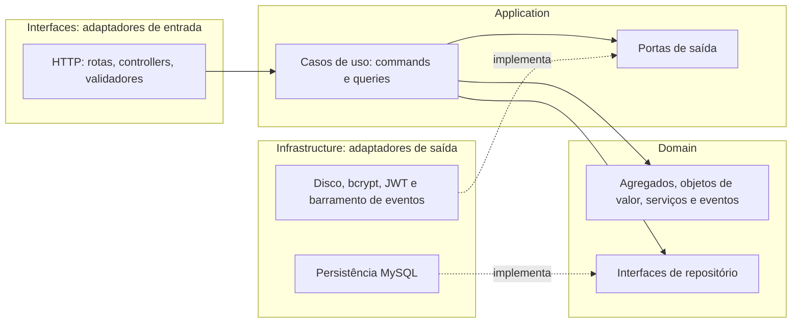
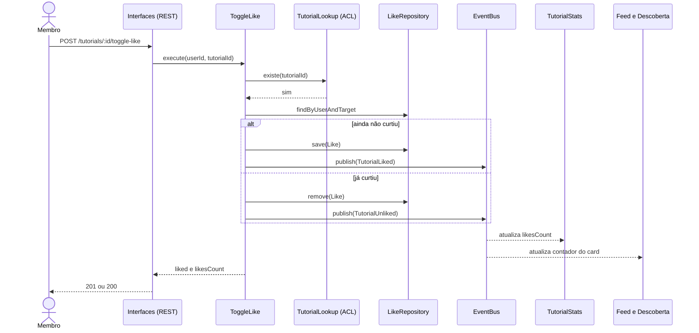
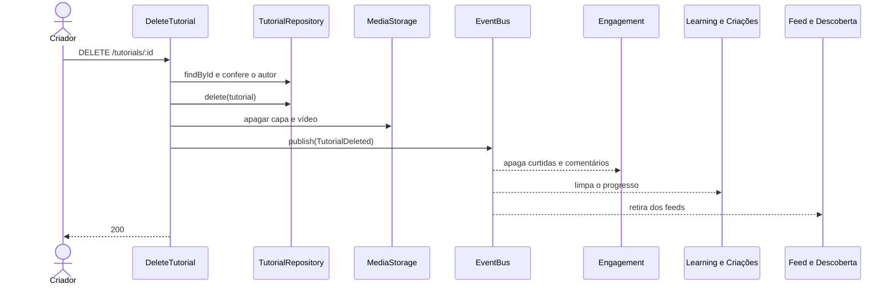

# 5. Arquitetura em camadas e estrutura de pastas

## 5.1 Camadas de cada contexto



**Regra de dependência:** as setas apontam sempre para dentro, em direção ao domínio. O domínio não importa nada de fora. A infraestrutura depende das portas (é ela que as implementa), e não o contrário. É a **inversão de dependência**.

| Camada | Pode depender de | Nunca depende de |
|---|---|---|
| `domain` | Apenas do `shared-kernel` | Express, Sequelize, Multer, bcrypt, JWT, outros contextos |
| `application` | `domain` e `shared-kernel` | Express, SQL, implementações concretas |
| `infrastructure` | `application` e `domain` (para implementá-los) | `interfaces` |
| `interfaces` | `application` | `domain` diretamente e `infrastructure` |

## 5.2 Estrutura do repositório

```text
craftcorner-ddd/
├── README.md
├── docs/
│   ├── 01-dominio-e-subdominios.md
│   ├── 02-linguagem-ubiqua.md
│   ├── 03-contextos-delimitados-e-context-map.md
│   ├── 04-modelo-tatico.md
│   ├── 05-arquitetura-em-camadas.md
│   ├── 06-eventos-de-dominio.md
│   ├── 07-mapeamento-projeto-atual.md
│   ├── 08-decisoes-arquiteturais.md
│   ├── 09-camada-de-mensageria.md
│   ├── apresentacao.md
│   └── c4/                       (diagramas C4: contexto, contêineres e componentes)
├── src/
│   ├── bootstrap/
│   ├── shared-kernel/
│   └── contexts/
│       ├── administration-moderation/
│       │   ├── application/
│       │   ├── domain/
│       │   ├── infrastructure/
│       │   └── interfaces/
│       ├── community/
│       │   ├── application/
│       │   ├── domain/
│       │   ├── infrastructure/
│       │   └── interfaces/
│       ├── engagement/
│       │   ├── application/
│       │   ├── domain/
│       │   ├── infrastructure/
│       │   └── interfaces/
│       ├── feed-discovery/
│       │   ├── application/
│       │   ├── domain/
│       │   ├── infrastructure/
│       │   └── interfaces/
│       ├── identity-access/
│       │   ├── application/
│       │   ├── domain/
│       │   ├── infrastructure/
│       │   └── interfaces/
│       ├── learning-creations/
│       │   ├── application/
│       │   ├── domain/
│       │   ├── infrastructure/
│       │   └── interfaces/
│       └── tutorial-catalog/
│           ├── application/
│           ├── domain/
│           ├── infrastructure/
│           └── interfaces/
└── tests/
```

## 5.3 Anatomia de um contexto (Tutorial Catalog)

```text
tutorial-catalog/
├── application/
│   ├── commands/
│   ├── event-handlers/
│   ├── ports/
│   └── queries/
├── domain/
│   ├── aggregates/
│   ├── events/
│   ├── repositories/
│   ├── services/
│   └── value-objects/
├── infrastructure/
│   ├── adapters/
│   └── persistence/
└── interfaces/
    └── http/
```

## 5.4 Fluxo de um caso de uso: curtir um tutorial



O controller não tem regra de negócio: traduz HTTP em um comando e devolve o resultado. O `401` vem do middleware, o `404` da porta de consulta e o `403`, quando existe, da política do domínio.

## 5.5 Fluxo de exclusão com eventos



A ordem é **banco primeiro, disco depois**: se o banco falhar, nada mudou; se o disco falhar depois, só sobra um arquivo perdido, sem corromper o sistema.

## 5.6 Compatibilidade com a arquitetura hexagonal

A estrutura já é hexagonal: o **domínio e a aplicação formam o núcleo**; as **portas** ficam em `domain/repositories` e `application/ports`; os **adaptadores de entrada** ficam em `interfaces/http` e os **de saída** em `infrastructure`. Trocar o MySQL ou o disco por outra tecnologia significa escrever um novo adaptador, sem mexer no núcleo.


## 5.7 Portas e adaptadores por contexto

Cada porta de saída é uma interface; o adaptador é a tecnologia que a implementa. O núcleo (domínio e aplicação) só enxerga a porta.

| Contexto | Portas de saída (interfaces) | Adaptadores de saída que as implementam | Adaptadores de entrada |
|---|---|---|---|
| **Identity & Access** | `PasswordHasher`, `TokenIssuer`, `EventPublisher`, `UserRepository` | `SequelizeUserRepository.js`, `BcryptPasswordHasher.js`, `JwtTokenIssuer.js` | `authRoutes.js` |
| **Community** | `TutorialCatalogReader`, `AvatarStorage`, `EventPublisher`, `ProfileRepository`, `FollowRepository` | `SequelizeProfileRepository.js`, `SequelizeFollowRepository.js`, `LocalAvatarStorage.js`, `CatalogApiTutorialReader.js` | `profileRoutes.js` |
| **Tutorial Catalog** | `MediaStorage`, `TutorialStatsReader`, `UnitOfWork`, `EventPublisher`, `TutorialRepository`, `CategoryRepository` | `SequelizeTutorialRepository.js`, `SequelizeCategoryRepository.js`, `LocalDiskMediaStorage.js`, `EngagementApiStatsReader.js`, `SequelizeUnitOfWork.js` | `tutorialRoutes.js`, `categoryRoutes.js` |
| **Engagement** | `TutorialLookup`, `UnitOfWork`, `EventPublisher`, `LikeRepository`, `CommentRepository`, `RatingRepository` | `SequelizeLikeRepository.js`, `SequelizeCommentRepository.js`, `SequelizeRatingRepository.js`, `TutorialStatsStore.js`, `CatalogApiTutorialLookup.js`, `SequelizeUnitOfWork.js` | `engagementRoutes.js` |
| **Learning & Creations** | `TutorialLookup`, `MediaStorage`, `EventPublisher`, `ProjectProgressRepository`, `CreationRepository` | `SequelizeProjectProgressRepository.js`, `SequelizeCreationRepository.js`, `LocalDiskMediaStorage.js`, `CatalogApiTutorialLookup.js` | `learningRoutes.js` |
| **Feed & Discovery** | `FeedReadStore`, `TutorialStatsReader` | `SqlFeedReadStore.js`, `EngagementApiStatsReader.js` | `feedRoutes.js`, `searchRoutes.js` |
| **Administration & Moderation** | `DashboardReader`, `EventPublisher`, `ModerationActionRepository` | `SequelizeModerationActionRepository.js`, `SqlDashboardReader.js` | `adminRoutes.js` |

**`EventPublisher`** é implementado uma única vez, na raiz de composição (`bootstrap`), e injetado em todos os contextos. Na versão inicial, o adaptador é o `InProcessEventBus` (em memória); com a camada de mensageria ([doc 09](09-camada-de-mensageria.md)), passa a ser o `OutboxEventPublisher`, que entrega os eventos ao RabbitMQ. Os contextos não percebem a troca.

**Porta de entrada:** os casos de uso (`commands` e `queries`) são a porta de entrada do núcleo. O adaptador HTTP chama o caso de uso e nunca o domínio diretamente.
