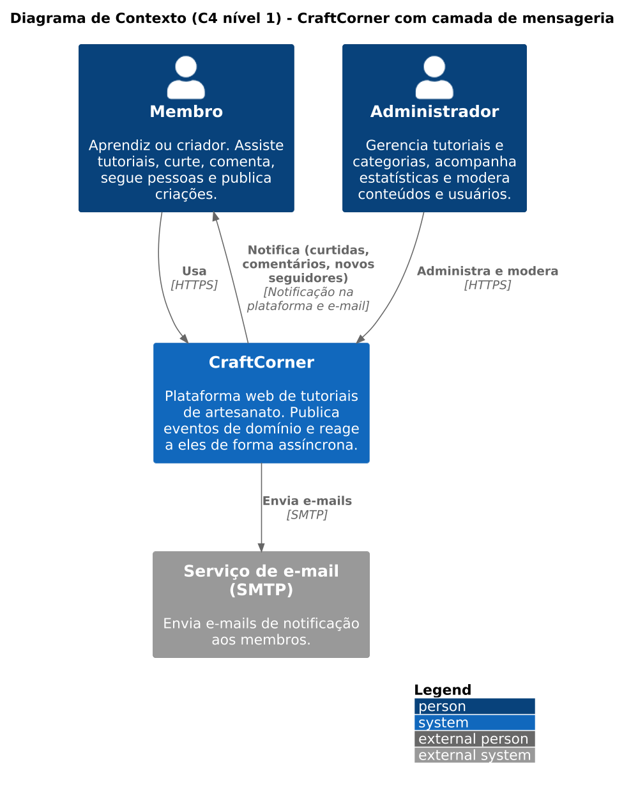
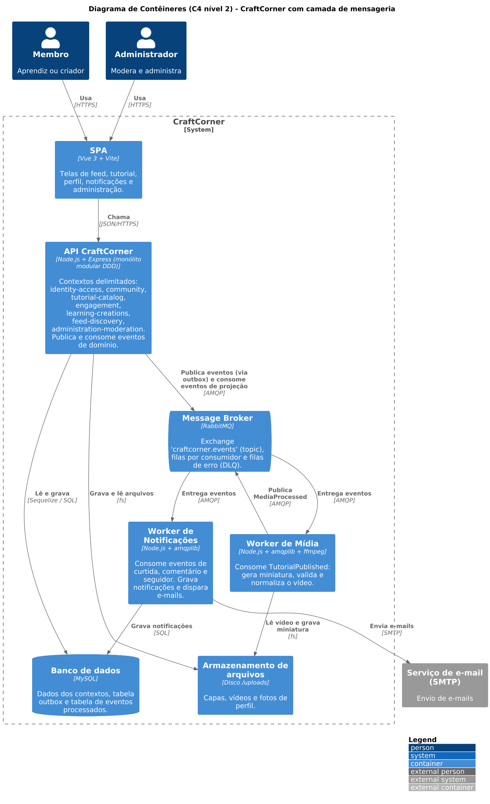
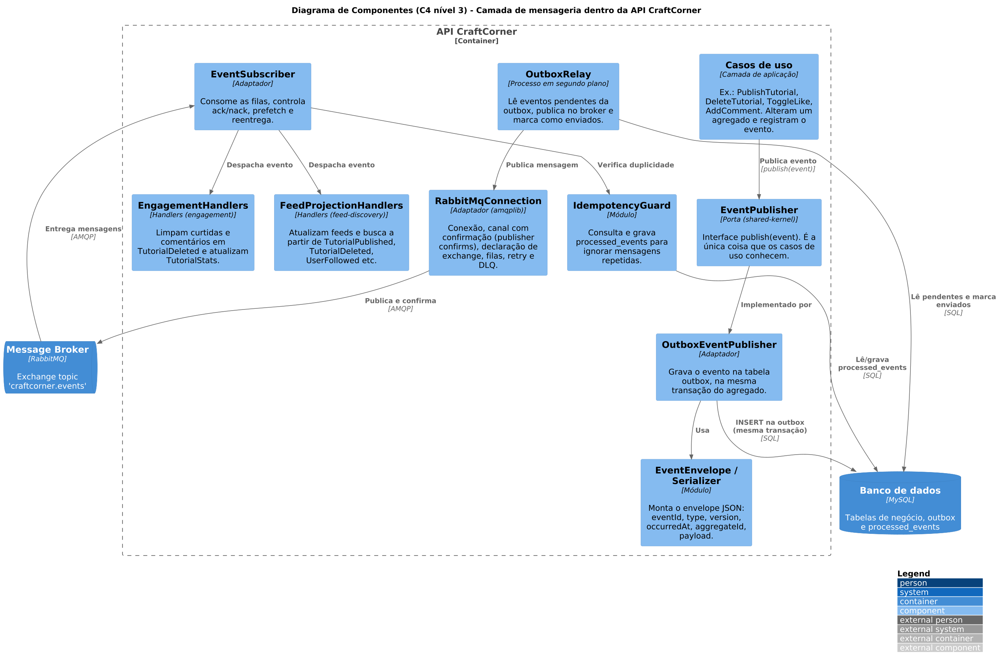

# 9. Camada de mensageria (comunicação entre módulos e processos)

## 9.1 Ponto de partida e proposta

Os contextos já se comunicam por **eventos de domínio** ([capítulo 6](06-eventos-de-dominio.md)), por meio de um barramento **em memória** (`InProcessEventBus`, [ADR-005](08-decisoes-arquiteturais.md)). Ele só funciona dentro de um único processo e perde os eventos se a aplicação cair.

A camada de mensageria troca esse barramento por um **message broker (RabbitMQ)**, sem alterar agregados nem casos de uso, porque eles só conhecem a porta `EventPublisher` (decisão no [ADR-008](08-decisoes-arquiteturais.md)). Com o broker, a API também passa a se comunicar com dois processos independentes (**workers**):

- **Worker de Notificações:** hospeda os handlers de notificação do contexto **Community** (curtidas, comentários e novos seguidores).
- **Worker de Mídia:** hospeda os handlers de mídia do contexto **Tutorial Catalog** (miniatura e validação do vídeo). Ao terminar, publica `MediaProcessed`.

Os workers não são contextos novos: são **unidades de execução** que rodam os handlers de um contexto em um processo à parte.

## 9.2 Diagramas C4

Os arquivos-fonte em PlantUML estão em [`c4/`](c4).

### Nível 1: Contexto

### Nível 2: Contêineres

Novos contêineres: **Message Broker (RabbitMQ)**, **Worker de Notificações** e **Worker de Mídia**. A API continua sendo um monólito modular, que agora publica e consome eventos pelo broker.

### Nível 3: Componentes da camada de mensageria

**Publicação:** o caso de uso salva o agregado e chama `EventPublisher.publish`. O `OutboxEventPublisher` grava o evento na tabela `outbox`, **na mesma transação**. O `OutboxRelay` lê os eventos pendentes e os publica no RabbitMQ, que confirma o recebimento.
**Consumo:** o `EventSubscriber` recebe a mensagem, o `IdempotencyGuard` descarta as repetidas e o handler do contexto atualiza apenas os dados do seu contexto.

## 9.3 Justificativas de negócio

| Necessidade de negócio | Problema sem a mensageria | Como a mensageria resolve |
|---|---|---|
| **Notificar membros** (curtidas, comentários, novos seguidores), com e-mail opcional | A curtida teria de chamar direto o módulo de notificação e o serviço de e-mail. Se o e-mail estiver lento, a curtida também fica lenta. | `TutorialLiked`, `CommentAdded` e `UserFollowed` são publicados. O Worker de Notificações consome no seu ritmo, e uma falha de e-mail não afeta quem curtiu. |
| **Processar vídeos e capas** | Tutoriais são vídeos. Gerar miniatura e validar o arquivo durante o upload deixaria a requisição lenta. | `TutorialPublished` aciona o Worker de Mídia em segundo plano. O membro publica e recebe a resposta na hora. |
| **Manter feeds e contadores consistentes** | Apagar um tutorial exige limpar curtidas, comentários, feeds e arquivos. Se um passo falhar, o sistema fica inconsistente. | `TutorialDeleted` é entregue a cada contexto, que limpa só os seus dados. Mensagens com falha são reenviadas e, esgotadas as tentativas, vão para uma fila de erro. |
| **Moderação efetiva** | `ContentHidden` e `UserSuspended` precisam chegar a vários contextos. | Um único evento publicado é entregue a todos os interessados. Novos interessados entram sem mudar a Administração. |
| **Crescer sem reescrever** | Cada nova funcionalidade alteraria quem produz o evento. | Um novo consumidor cria uma fila e se inscreve no evento que já existe. |

Atributos de qualidade atendidos: **desacoplamento**, **resiliência**, **escalabilidade** (workers podem ser replicados) e **responsividade** (trabalho pesado fora da requisição).

## 9.4 Topologia do broker

**Exchange:** `craftcorner.events`, do tipo `topic`. A chave de roteamento é o nome do evento em formato `agregado.fato` (ex.: `TutorialPublished` vira `tutorial.published`; `ProjectCompletionRevoked` vira `project.completion-revoked`).

| Fila | Quem consome | Chaves de interesse |
|---|---|---|
| `feed.q` | Feed & Discovery | `tutorial.published`, `tutorial.details-changed`, `tutorial.cover-replaced`, `tutorial.deleted`, `tutorial.hidden`, `tutorial.restored`, `category.created`, `media.processed`, `tutorial.liked`, `tutorial.unliked`, `user.followed`, `user.unfollowed`, `profile.updated`, `creation.posted`, `creation.deleted`, `content.hidden`, `content.restored` |
| `engagement.q` | Engagement | `tutorial.deleted`, `tutorial.hidden`, `tutorial.restored`, `creation.deleted`, `content.hidden`, `content.restored`, `user.suspended`, e os próprios `tutorial.liked`, `tutorial.unliked`, `comment.added`, `comment.removed`, `tutorial.rated`, `tutorial.viewed` (para a projeção `TutorialStats`) |
| `learning.q` | Learning & Creations | `tutorial.deleted`, `content.hidden`, `content.restored`, `user.suspended` |
| `catalog.q` | Tutorial Catalog | `content.hidden`, `content.restored`, `media.processed` |
| `identity.q` | Identity & Access | `user.suspended`, `user.reactivated` |
| `community.q` | Community | `user.registered`, `user.followed`, `user.unfollowed` (contadores) |
| `admin.q` | Administration & Moderation | `user.registered`, `tutorial.published`, `tutorial.liked`, `comment.added`, `project.completed`, `project.completion-revoked` |
| `notifications.q` | Worker de Notificações | `tutorial.liked`, `comment.added`, `user.followed` |
| `media.q` | Worker de Mídia | `tutorial.published`, `tutorial.cover-replaced` |

Cada fila tem uma **fila de erro** (`<fila>.dlq`) e uma fila de espera para o reenvio com atraso.

## 9.5 Escolhas técnicas

**Broker: RabbitMQ.**

| Opção | Vantagens | Por que não foi escolhida |
|---|---|---|
| Barramento em memória (atual) | Simples, sem infraestrutura | Não sobrevive à queda do processo e não alcança workers separados |
| **RabbitMQ** | Roteamento flexível por *topic exchange*, confirmação de entrega, reenvio e filas de erro prontas, simples de operar | **Escolhido** |
| Apache Kafka | Alto volume, histórico reprocessável | Excessivo para o porte do projeto, com operação e aprendizado mais pesados |
| Redis Streams / Pub/Sub | Leve e comum | Pub/Sub perde mensagens sem consumidor ativo; Streams tem menos recursos de roteamento e filas de erro |
| Serviço gerenciado (SQS/SNS) | Sem operar servidor | Custo e dependência de nuvem fora do escopo |

**Decisões de projeto**

- **Publicação confiável (outbox):** o evento é gravado no MySQL junto com o agregado e só depois enviado ao broker. Nunca existe dado salvo sem evento, nem evento sem dado.
- **Entrega ao menos uma vez + idempotência:** o consumo usa confirmação manual (`ack`). Como a mesma mensagem pode chegar duas vezes, o `IdempotencyGuard` registra o `eventId` em `processed_events`.
- **Falhas:** reenvio com atraso e, depois de algumas tentativas, a mensagem vai para a fila de erro em vez de bloquear a fila.
- **Formato:** JSON com envelope fixo (`eventId`, `type`, `version`, `occurredAt`, `aggregateId`, `payload`). O campo `version` permite evoluir o evento sem quebrar consumidores antigos.
- **Biblioteca:** `amqplib` (Node.js), com confirmação de publicação (*publisher confirms*) e `prefetch` no consumo.
- **Consistência:** entre contextos é **eventual** (seção 6.3). Dentro de cada agregado continua imediata.
- **Impacto na arquitetura DDD:** só a camada de infraestrutura muda (um novo adaptador de `EventPublisher`). Domínio e aplicação permanecem intactos, o que demonstra a inversão de dependência.

## 9.6 Onde cada peça fica no repositório

| Peça | Local |
|---|---|
| Porta `EventPublisher` e base do evento | `src/shared-kernel/` |
| `OutboxEventPublisher`, `OutboxRelay`, `RabbitMqConnection`, `EventSubscriber`, `IdempotencyGuard`, `EventEnvelope` | `src/bootstrap/messaging/` |
| Workers de notificações e de mídia | `src/bootstrap/workers/` |
| Handlers de cada contexto | `src/contexts/<contexto>/application/event-handlers/` |
| Diagramas C4 (`.puml` e `.png`) | `docs/c4/` |
